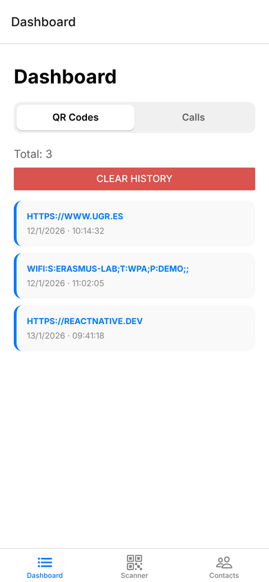
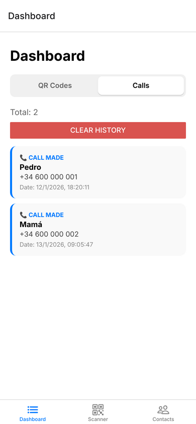

# Native Manager Suite


Aplicación móvil multiplataforma (Android e iOS) hecha con **React Native** y **Expo**. Reúne en una sola app varias funciones que usan las **APIs nativas del teléfono**:

- un **lector de códigos QR** que usa la cámara;
- la **agenda de contactos**, desde la que se puede llamar y marcar contactos de emergencia;
- **notificaciones locales**;
- un **panel con el historial** de QR escaneados y llamadas, que se conserva al cerrar la app.

> **Proyecto propio, hecho desde cero** por Pedro ([@PedroFC14](https://github.com/PedroFC14)) y José ([@joseaguilaar](https://github.com/joseaguilaar)) para una asignatura de nuestro **Erasmus**. Todo el código de la aplicación es nuestro.

---

## Capturas

<p align="center">
  
  &nbsp;&nbsp;
  
</p>
<p align="center"><em>Dashboard: historial de QR escaneados y de llamadas (con datos de ejemplo).</em></p>

<!--
  Vídeo de demostración: grabad la pantalla del móvil, arrastrad el .mp4 a la caja
  de edición de este README en GitHub y pegad aquí el enlace que se genera.
-->

## Funcionalidades

### Escáner QR
- Pide permiso para usar la cámara y abre la **cámara trasera a pantalla completa** (`expo-camera`).
- Detecta solo **códigos QR** e ignora otros códigos de barras.
- Al leer uno, el móvil **vibra** para confirmarlo (`expo-haptics`) y muestra su contenido en pantalla.
- Si el QR contiene una **URL**, la abre automáticamente en el navegador (`Linking`).
- Guarda cada lectura en el historial con su **fecha y hora**. El botón *Scan another QR* permite seguir escaneando.

### Contactos
- Lee la **agenda del teléfono** (`expo-contacts`), previo permiso, y muestra solo los contactos que tienen número.
- Tiene un **buscador** que filtra por nombre o por número mientras se escribe.
- Usa `FlatList` en lugar de `ScrollView`, que solo dibuja los contactos visibles y reutiliza las vistas al hacer scroll. Así la app funciona bien aunque la agenda tenga cientos de contactos.
- Al tocar un contacto se abre una ventana emergente (`Modal`) con varias opciones:
  - **Llamar**: abre la app de Teléfono del sistema (`tel:`) y registra la llamada en el historial.
  - **Marcar como emergencia**: el contacto pasa a verse en rojo y, cada vez que se selecciona, la app lanza una **notificación local** (`expo-notifications`).
- `SafeAreaView` hace que la interfaz se adapte a muescas, a la isla dinámica y a los distintos tamaños de pantalla.

### Dashboard
- Tiene dos pestañas, **QR Codes** y **Calls**, y muestra el número total de registros de la que está abierta.
- Incluye un botón para **borrar el historial**, que pide confirmación antes de hacerlo.
- Muestra un mensaje cuando la lista está vacía.

### Estado global y persistencia
- Un `AppContext` (Context API de React) comparte los historiales entre todas las pantallas.
- Los datos se guardan en el teléfono con **AsyncStorage**: se cargan al abrir la app y se guardan cada vez que cambian, así que se conservan al cerrarla.

## Arquitectura

```
index.js              punto de entrada (registerRootComponent)
└── App.js            AppProvider + NavigationContainer
    ├── src/context/AppContext.js       estado global (historial de QR y de llamadas) + AsyncStorage
    └── src/navigation/BottomTabs.js    barra de pestañas inferior
        ├── src/screens/DashboardScreen.js
        ├── src/screens/ScannerScreen.js
        └── src/screens/ContactsScreen.js
```

## Tecnologías

| Área | Herramientas |
|---|---|
| Framework | React Native 0.81, React 19, Expo SDK 54 |
| Navegación | React Navigation (Bottom Tabs) |
| APIs nativas | `expo-camera`, `expo-contacts`, `expo-notifications`, `expo-haptics`, `Linking` |
| Estado y persistencia | Context API, `useState` / `useEffect`, AsyncStorage |
| Calidad | ESLint (`eslint-config-expo`) |

## Cómo ejecutarla

**Requisitos:** Node.js (versión LTS) y la app **Expo Go** instalada en el móvil ([Android](https://play.google.com/store/apps/details?id=host.exp.exponent) / [iOS](https://apps.apple.com/app/expo-go/id982107779)).

```bash
git clone https://github.com/PedroFC14/React-Native-Project.git
cd React-Native-Project
npm install
npx expo start
```

Después, escanea el QR que aparece en la terminal con Expo Go (en Android) o con la cámara (en iOS).

## Autores

- **Pedro**: [@PedroFC14](https://github.com/PedroFC14)
- **José**: [@joseaguilaar](https://github.com/joseaguilaar)
